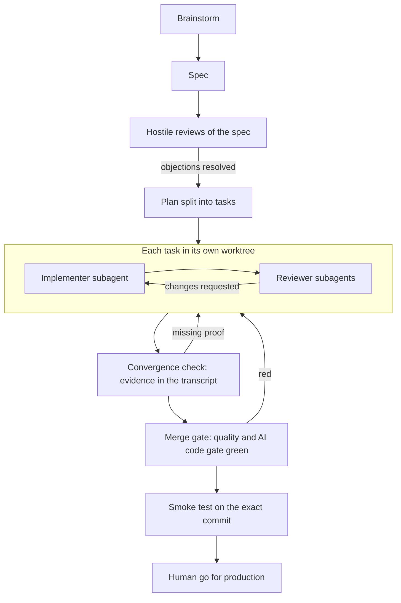

# Claude Code governance kit

Speed from coding agents, without losing control of what reaches production.

## Pour les lecteurs francophones

Ce kit rassemble une couche de gouvernance pour Claude Code, issue d'un SaaS en production : un contrat de règles dures réinjecté à chaque session, un journal des dérives qui durcit les règles, une commande anti-complaisance, deux skills de vérification et une description de gate CI conçu pour le code écrit par des agents. Il s'adresse aux CTO et lead devs qui veulent industrialiser Claude Code en équipe sans perdre la main. Tout est en anglais, court, et s'installe en deux minutes. Questions ou retours : contactez-moi sur LinkedIn (lien en bas de page).

## What this is

A small, opinionated set of files you drop into a repository's `.claude/` folder. It organizes agent governance in **three levels**:

| Level | File | Loaded | Nature |
| --- | --- | --- | --- |
| 1. Memory | auto memory, `memory/drift-log.md` | on demand | **Advisory.** Lessons and context; the agent *may* ignore it. |
| 2. Contract | `CONTRACT.md` | **re-injected at every session start, resume, clear and compaction** by a hook | **Hard rules**, short enough to read in one minute. |
| 3. Doctrine | `CLAUDE.md` | every session | **How we work**: structure, commands, gates, merge procedure, session closing. |

The idea: long doctrine gets diluted as a session grows, and a compaction can summarize away the one rule that mattered. A short contract, re-injected by a hook, keeps the non-negotiables at full strength. The drift log closes the loop: every time a rule is ignored in practice, it is logged, and a rule that drifts two or three times gets hardened (rewritten, enforced by a hook or a gate, or promoted).

## Why

Coding agents make a small team fast. They also produce plausible code faster than anyone can review it, agree too easily, and report success with confidence. The kit rests on two beliefs:

- **Speed without losing control is a design problem**, not a discipline problem. Put the rules where the agent cannot miss them, and back the critical ones with hooks and permissions.
- **Code generated by agents must pass gates**, and "done" means proven by command output in the transcript, never by a summary.

## What's inside

```
CONTRACT.md                          14 hard rules, each with a one-line rationale
hooks/inject-contract.sh             SessionStart hook (POSIX sh) that re-injects the contract
hooks/settings.example.json          hook wiring + deny rules for secret files
hooks/README.md                      how it works, and the hooks worth building next
memory/drift-log.md                  drift log format with three invented examples
commands/rodin.md                    /rodin: anti-complacency sparring on a decision
skills/verify-frontend-change/       no UI change is done until verified in a real browser
skills/regulated-communication/      guardrails for public copy in regulated sectors
templates/CLAUDE.md.template         doctrine skeleton, including the 20/80 frame
templates/goal-template.md           convergence check with evidence required in the transcript
docs/ai-code-gate.md                 one-page design of a CI gate for agent-written code
```

## Install in two minutes

```sh
git clone https://github.com/Mathys6/claude-code-governance-kit.git ~/claude-code-governance-kit
KIT=~/claude-code-governance-kit
cd /path/to/your-project

mkdir -p .claude/hooks .claude/memory .claude/commands .claude/skills
cp "$KIT/CONTRACT.md" .claude/
cp "$KIT/hooks/inject-contract.sh" .claude/hooks/ && chmod +x .claude/hooks/inject-contract.sh
cp "$KIT/memory/drift-log.md" .claude/memory/
cp "$KIT/commands/rodin.md" .claude/commands/
cp -R "$KIT/skills/." .claude/skills/
[ -f CLAUDE.md ] || cp "$KIT/templates/CLAUDE.md.template" CLAUDE.md
```

Then merge `hooks/settings.example.json` into `.claude/settings.json` (the `SessionStart` block and the `deny` rules), and check:

```sh
sh .claude/hooks/inject-contract.sh | head
```

Start Claude Code and ask "what does rule 5 of the contract say?". Then edit `CONTRACT.md`: the rules are generic on purpose, and a contract only works once it speaks about *your* production, *your* gates and *your* generated files.

## The workflow it supports



Not every task deserves this. The **20/80 frame** in the `CLAUDE.md` template is a judgment filter applied before each task: throwaway work and one-line fixes go direct, while anything touching production, data, security, money or permissions gets the full path. Over-engineering a throwaway costs as much as under-engineering a release.

## Model routing

**A reasoning model plans and reviews, an execution model implements.** Brainstorming, specs, hostile reviews, code review and the convergence judgment go to the strongest reasoning model available. Implementer subagents, which follow a precise plan in an isolated worktree, run on a faster execution model. The plan carries the intelligence; the implementer carries the volume; reviewers sit back on the reasoning side so that the model that wrote the code is never the only one judging it. In Claude Code, this maps to the `model` field of each subagent definition.

## What this is not

- **Not a security boundary.** The contract is text in the context; an agent can still ignore it. That is why the drift log exists, and why the critical rules must also be enforced by permissions, hooks and CI.
- **Not a replacement** for code review, branch protection or a real CI gate. It makes them harder to bypass by accident.
- **Not plug-and-play doctrine.** The rules are generic. Adapt them, or they will be read and not applied.
- **Not legal advice.** The regulated-communication skill is a guardrail against invented claims, not a compliance review.
- **Not the whole system.** The multi-session hooks (worktree confinement, resource locks, CI watcher) are described in `hooks/README.md`, not shipped: they depend too much on each repository.
- **Not battle-tested by others yet.** This is 0.1.0, distilled from one team's practice. Issues and feedback are welcome.

## Origin and author

Built by **Mathys Anquetil**, cofounder and AI Product Engineer at SantéMobile. The kit distills practice from a production SaaS built by a two-person team in a regulated sector. Everything here has been rewritten and anonymized; no code or internal detail from that product is included.

- LinkedIn: [Mathys Anquetil](https://www.linkedin.com/in/mathys-anquetil/)
- GitHub: [Mathys6](https://github.com/Mathys6)

## License

MIT, see [LICENSE](LICENSE).
